<p align="center">
  
</p>

<h1 align="center">GOLBIT — Futbol İstatistik ve Analiz</h1>

<p align="center">
  Günün maçlarını otomatik toplayan, her maç için istatistik modeliyle olasılık hesaplayan<br/>
  ve sonuçlardan kendi kendine öğrenen Android uygulaması ve web sitesi.
</p>

<p align="center">
  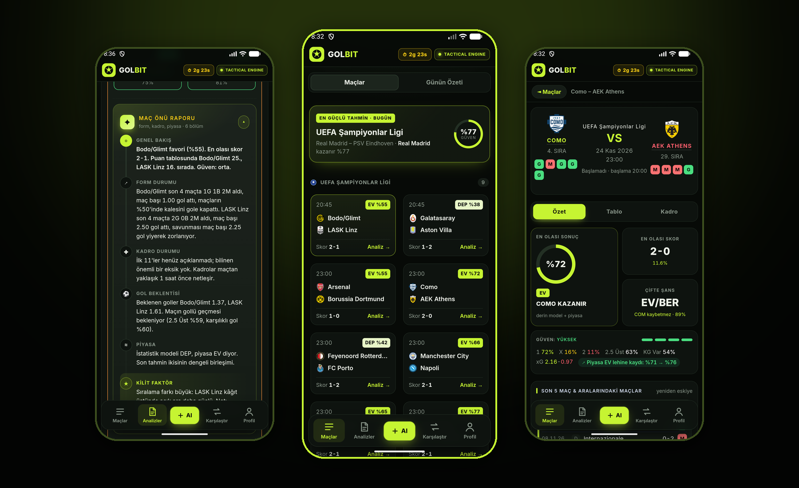
</p>

> **Kaynak kod gizlidir.** Bu depo yalnızca projenin tanıtımıdır. Kodu incelemek isteyen işverenlerle
> talep üzerine paylaşabilirim — iletişim bilgisi aşağıda.

---

## Öne çıkanlar

- **Sıfır elle veri girişi:** uygulama açıldığında günün tüm maçları, puan tabloları, takım formları, kadrolar ve oranlar internetten kendiliğinden gelir; maç bitince skor otomatik işlenir.
- **Derin istatistik modeli:** Poisson + Dixon-Coles gol modeli; yakın maçlara daha çok ağırlık, rakip gücüne göre düzeltme, şut verisi, milli takımlarda Elo puanı, ilk 11'e göre eksik oyuncular, dinlenme süresi ve piyasa olasılıklarıyla harmanlama. Her maç 10.000 kez simüle edilir.
- **Kendi kendine öğrenme:** her analiz, o anki girdi verisiyle birlikte saklanır. Model biten maçları farklı ayarlarla yeniden hesaplar; eski %70'lik kısımda öğrenir, hiç görmediği yeni %30'lik kısımda sınanır. Değişiklik yalnızca olasılıklar iyileşir **ve** isabet belirgin düşmezse kabul edilir, o da yarım adımla uygulanır. Lige özel ayarlar 15 maçtan sonra devreye girer.
- **Gerçek sonuçlarla ölçüm:** Kasım 2026'da kaydedilen 117 biten maçta maç sonucu isabeti **%64**. Karşılaştır ekranı her tahmini gerçek skorla yan yana gösterir.
- **Maç önü raporu:** form serileri, iç saha/deplasman karnesi, aralarındaki maçlar, kadro durumu, gol beklentisi, piyasa hareketi ve “kilit faktör” verilerden otomatik yazılır; takım haberleri sakatlık etiketiyle listelenir.
- **Telefonda sunucusuz:** Android sürümünde veri motoru telefonda çalışır; liste hemen gelir, maç ayrıntıları arka planda sırayla yüklenir.
- **Paylaşılabilir kartlar:** günün en güvenilir iki maçı, Instagram hikâyesi boyutunda (1080×1920) görsel olarak üretilip tek dokunuşla paylaşılır.
- **Üyelik akışı:** 3 günlük ücretsiz deneme ve sayaç; sonrasında biten maçlar açık, oynanmamış maçların analizi Premium.

## Ekranlar

| | |
|---|---|
| 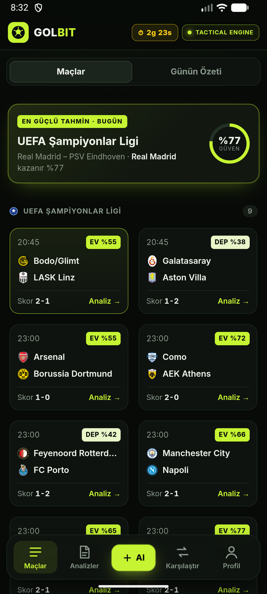 | 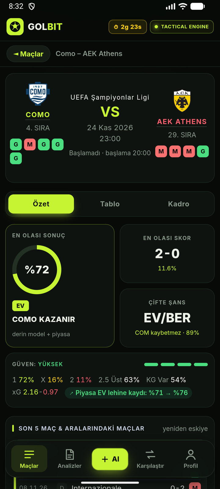 |
| **Maçlar** — günün maçları, tahmin rozetleri, en güçlü tahmin | **Maç analizi** — en olası sonuç, skor, çifte şans, güven |
| 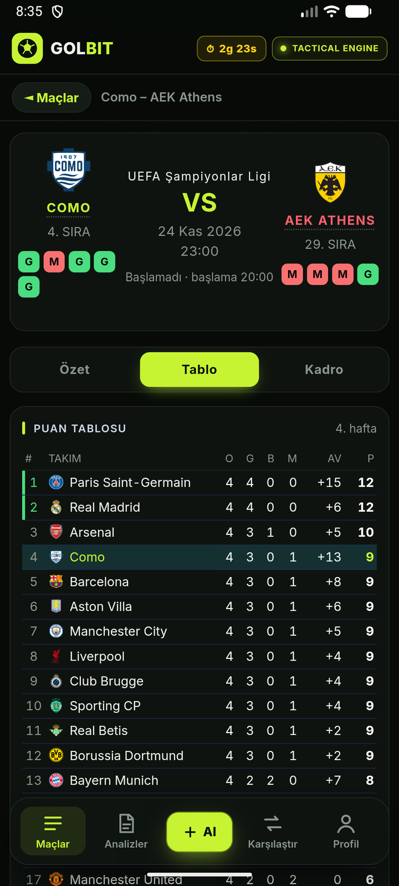 | 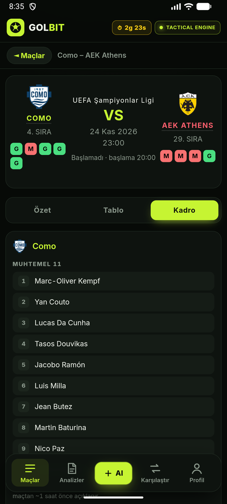 |
| **Tablo** — iki takım vurgulu puan durumu | **Kadro** — ilk 11 / muhtemel 11 ve eksikler |
| 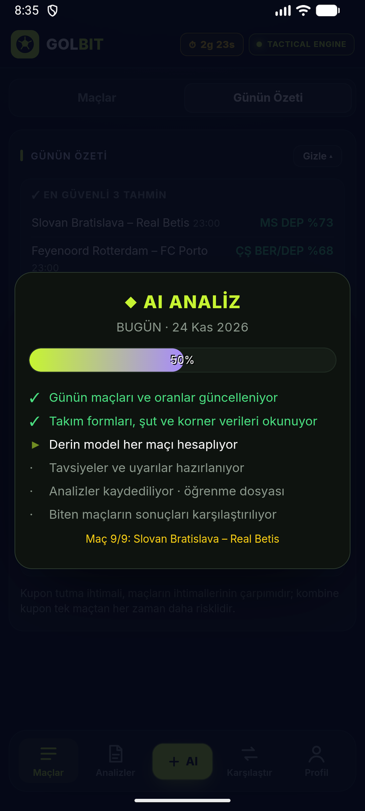 | 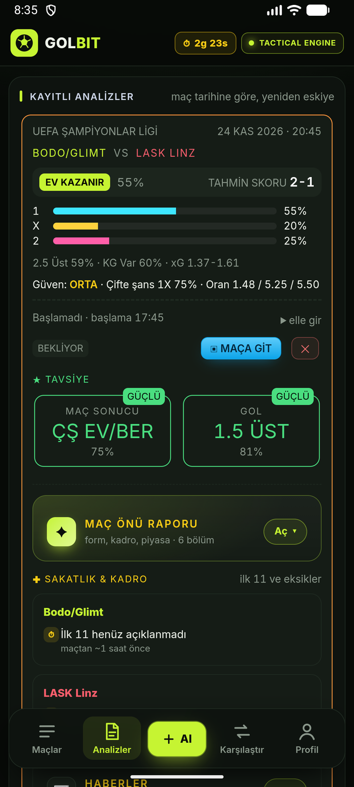 |
| **AI Analiz** — günün tüm maçları tek dokunuşla | **Analizler** — kayıtlı analizler ve canlı durum |
| 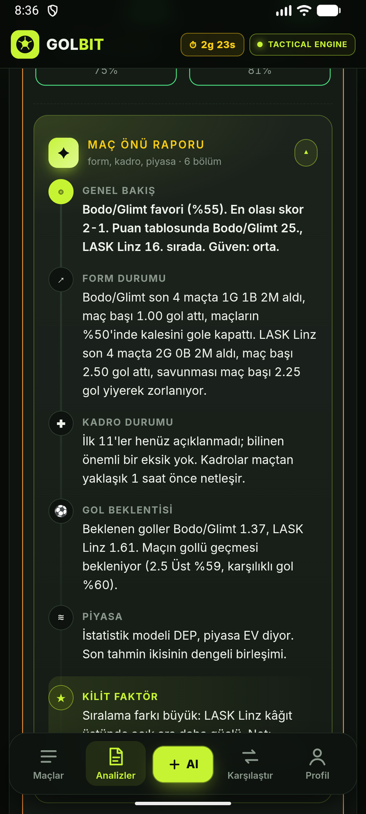 | 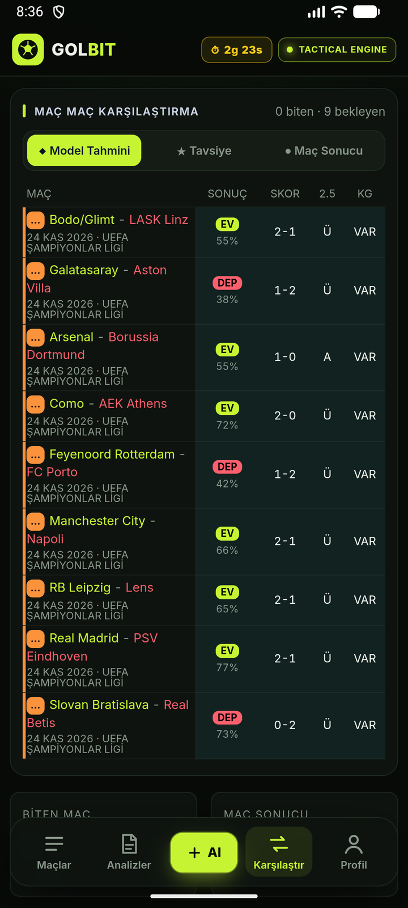 |
| **Maç önü raporu** — verilerden yazılan bölüm bölüm analiz | **Karşılaştır** — model tahmini / tavsiye / maç sonucu |
| 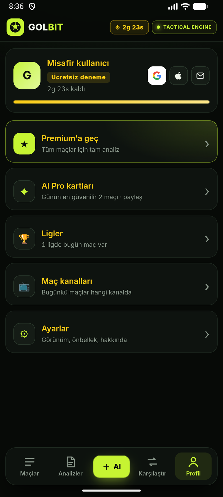 | 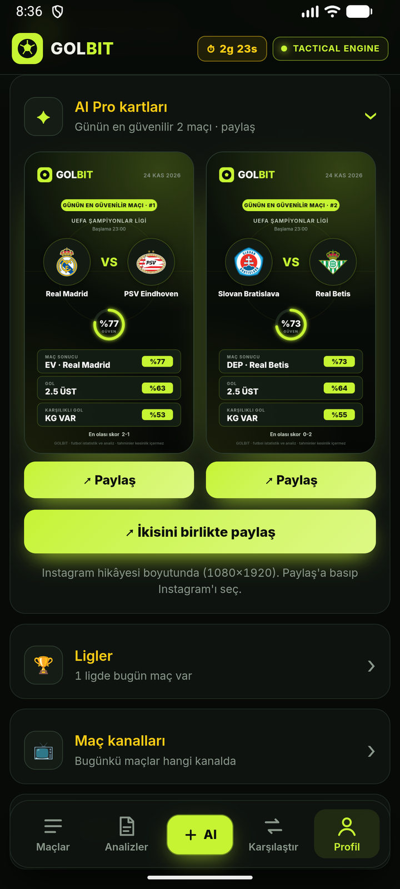 |
| **Profil** — üyelik, ligler, maç kanalları, ayarlar | **AI Pro kartları** — hikâye boyutunda paylaşım görselleri |

## Teknolojiler

| Katman | Kullanılanlar |
|---|---|
| Arayüz | HTML, CSS, saf JavaScript (çatı yok), Canvas ile grafik ve paylaşım kartı çizimi |
| Mobil | Capacitor 6 (Android), yerel HTTP ile doğrudan veri çekme, Share/Filesystem eklentileri, Android geri tuşu yönetimi |
| Veri | ESPN herkese açık skor/istatistik uçları, eloratings.net; tarayıcıda/telefonda önbellek |
| Masaüstü | Python yerel sunucu: günlük veri toplama, canlı skor ara katmanı, öğrenme dosyası |
| Model | Poisson + Dixon-Coles, Monte Carlo simülasyonu, ağırlıklı form, Elo, piyasa harmanlama, sınav setiyle doğrulanan öğrenme |

## Mimari (kısaca)

```
ESPN / Elo  ──>  Veri motoru (telefonda ya da yerel sunucuda)
                     │  günün maçları · tablo · form · kadro · oranlar
                     ▼
              Derin model  ──>  Olasılıklar, skor, güven, rapor
                     ▲                    │
                     │                    ▼
           Öğrenilen ayarlar  <──  Analiz kayıtları + gerçek sonuçlar
```

Her analiz o anki girdi verisinin bir kopyasıyla saklanır; böylece model ileride aynı maçları
farklı ayarlarla birebir yeniden hesaplayıp kendini sınayabilir.

## Durum

- ✅ Web sürümü ve Android test sürümü
- ✅ Otomatik veri, derin model, kendi kendine öğrenme, maç önü raporu, paylaşım kartları
- 🔜 Google Play yayını, Google Play Faturalandırma, Google ile giriş ve bulutta kayıt

## İletişim

Kodu incelemek veya proje hakkında konuşmak için: GitHub [@poticanakts-ux](https://github.com/poticanakts-ux)

---

<sub>Tahminler istatistik modeline dayanır ve kesinlik içermez. Takım adları ve logoları ilgili kulüplere aittir; yalnızca ekran görüntülerinde veri örneği olarak görünür. © Tüm hakları saklıdır.</sub>
